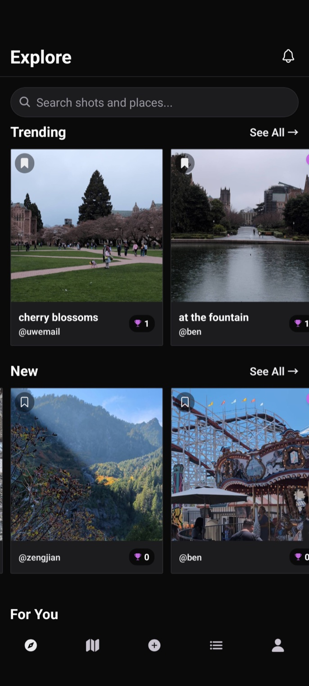
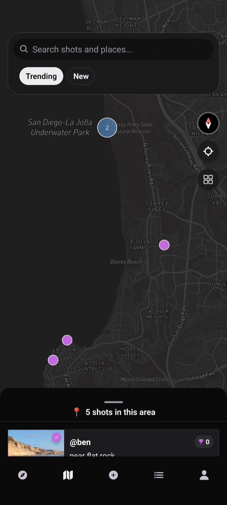
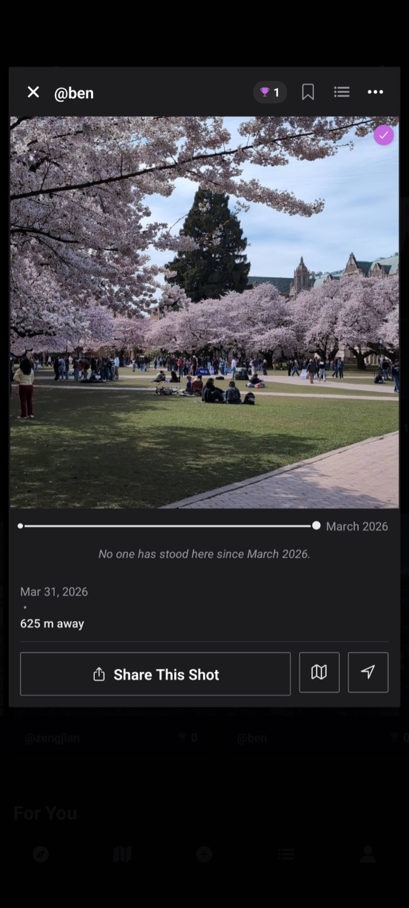
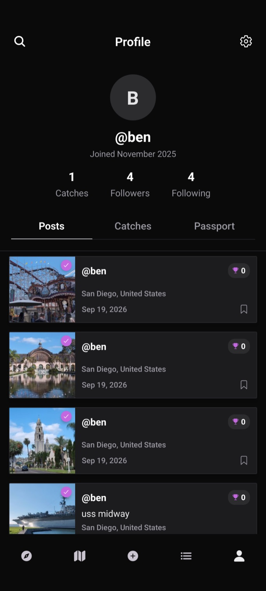

# Catch

<table align="center">
  <tr>
    <td align="center" width="50%"> <em>The Explore feed, showing photos posted by other users</em></td>
    <td align="center" width="50%"> <em>Browsing nearby posts on the map</em></td>
  </tr>
</table>

Catch is a location-based social app built around a simple idea: a user can post a photo of something cool, and other people can then "catch" that post by physically traveling there and recreating the shot. Posts land on a shared global map - great for travel inspiration and place discovery. Additionally, as more people catch the same photo, each thread can evolve to become a crowdsourced timeline of a place.

The client is React Native and Expo, connected to a Firebase backend. Locations are indexed with geohashes so the Mapbox-powered map and nearby-post queries stay fast as users pan around the map. Post locations are verified using location data and a vision model to ensure the integrity of the game, and to motivate users to go outside. Authentication is handled via Firebase's Google single sign-on.

## Features

Catching
- To catch a post, a user has to be physically near the original coordinates and submit a new photo from roughly the same vantage point.
- An on-device TensorFlow Lite model (a MobileNetV2 encoder fine-tuned on an image-matching pipeline) scores visual similarity between the original photo and the recreation, so a catch has to resemble the shot, not just be nearby.

Semantic search
- On every post creation, a Gemini vision-language model tags every single image for landmarks. These, along with the caption and location, are stored in a vector database as embeddings.
- A cosine-similarity search and a keyword matching system provide relevant results on search, reranked based on distance to the user.

Ranking
- Trending and For You feeds are ranked by a Reddit-style "hot" score that balances catch count against recency, kept up to date by Cloud Function triggers.

<table align="center">
  <tr>
    <td align="center" width="50%"> <em>A shot's detail view, with its timeline and distance away</em></td>
    <td align="center" width="50%"> <em>A user's profile, with their posts and catches</em></td>
  </tr>
</table>
